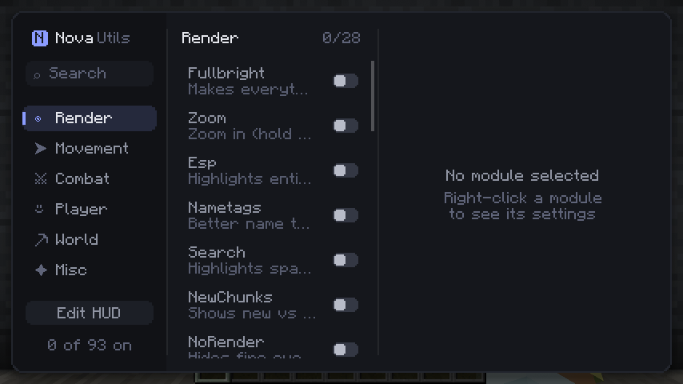
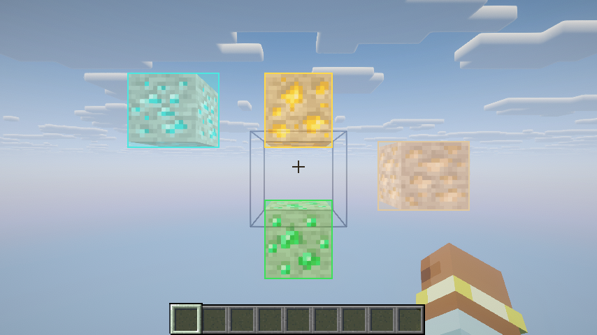
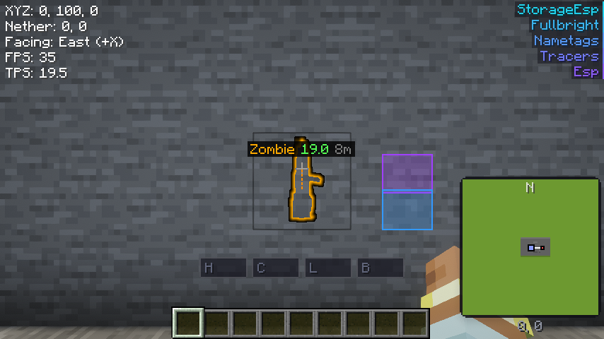
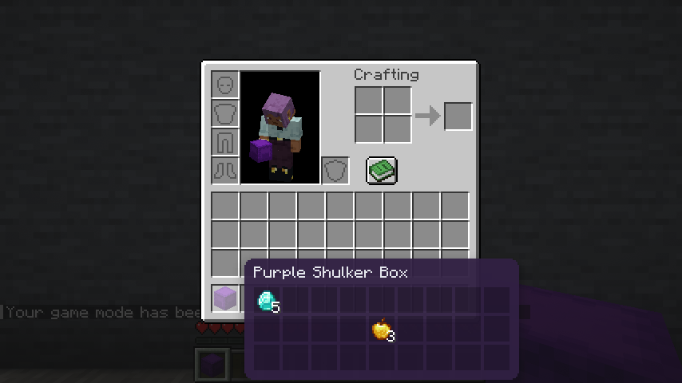

# NovaUtils

A client-side utility mod for Minecraft, in the spirit of Meteor Client: ESP, Xray, waypoints,
HUD, automation and a clean single-window menu. Everything runs on your side only; nothing has to
be installed on the server.



**Português:** NovaUtils é um mod de utilidades só do lado do cliente (tipo Meteor): ESP, Xray,
waypoints, HUD, automações e um menu limpo. Abra o menu com **Shift direito**. Os downloads estão
na pasta [`dist/`](dist). Funciona com Sodium/Iris e com Embeddium/Oculus (shaders inclusos).

## Downloads

Pick the jar for your loader and Minecraft version from [`dist/`](dist):

| Minecraft | Fabric | NeoForge | Forge |
|---|---|---|---|
| 26.3 | `novautils-fabric-0.1.0-mc26.3.jar` | `novautils-neoforge-0.1.0-mc26.3.jar` | |
| 26.1.2 | `novautils-fabric-0.1.0-mc26.1.2.jar` | `novautils-neoforge-0.1.0-mc26.1.2.jar` | |
| 1.20.1 | | | `novautils-forge-0.1.0-mc1.20.1.jar` |

Fabric needs [Fabric API](https://modrinth.com/mod/fabric-api). Drop the jar in your `mods` folder.

## Using it

- **Right Shift** opens the menu. **Delete** turns every module off (panic key).
- Left-click a module to toggle it, right-click it to open its settings.
- Any module can be bound to a key or a mouse button (side buttons too) from its settings.
- **Edit HUD** in the menu lets you drag the HUD elements (coords, armour, minimap, ...) anywhere.
- Settings are saved to `config/novautils.json`.

## Compatibility

- **Sodium + Iris** (Fabric) and **Embeddium + Oculus** (Forge 1.20.1): Xray works with both
  renderers, and ESP, tracers, waypoints and labels keep working with a shaderpack on.
- Tested alongside JEI/EMI, FancyMenu and large modpacks.

| Xray with a shaderpack (Forge 1.20.1, Embeddium + Oculus) | ESP, nametags, storage ESP and HUD |
|---|---|
|  |  |



## Modules

### Render
| Module | What it does |
|---|---|
| Fullbright | Makes everything fully lit, no more caves or night. |
| Xray | Hides everything but the ores you pick (see-through, like Meteor), or boxes them. |
| Esp | Highlights entities through walls (chams / box). |
| StorageEsp | Highlights chests, shulkers, barrels and more through walls. |
| Search | Finds spawners, portals, beacons and other rare blocks, with an alert and a counter. |
| Tracers | Lines from your crosshair to nearby entities. |
| Nametags | Better name tags: health, ping, distance, totem pops. |
| Waypoints | Named markers with distance, visible through walls. |
| Minimap | A small map with you, mobs, players and waypoints. |
| ShulkerPeek | Hover a shulker box to see what's inside. |
| BreakIndicator | Shows the progress of blocks being broken, yours and other players'. |
| HitsToKill | A mob's health and how many hits it still needs. |
| Trajectories | Where pearls, arrows and potions will land. |
| NewChunks | New vs already-loaded chunks (find trails). |
| LightOverlay | Where mobs can spawn, and the best spots for torches. |
| Freecam | Fly the camera freely while your body stays put. |
| Zoom | Zoom in, scroll to zoom further. |
| ViewModel | Size, position and tilt of your hands and items, enchant glint. |
| NoRender | Hides the fire overlay, hurt camera shake and the totem animation. |
| Trail, Breadcrumbs, LogoutSpots, ItemHighlight, HoleEsp, TunnelEsp, VoidEsp | Smaller visual helpers. |
| TimeChanger, WeatherChanger | Change the time and weather you see. |

### Movement
| Module | What it does |
|---|---|
| ElytraFly | Elytra flight: control, boost, 2b2t bounce, auto rockets. |
| BoatFly | Fly with a boat. |
| Flight, Speed, Step, HighJump, LongJump, AirJump | Classic movement. |
| Jesus, Spider, FastClimb | Walk on water, climb walls, faster ladders. |
| Scaffold, SafeWalk, Parkour, Sneak | Building and edge helpers. |
| AutoSprint, AutoWalk, AutoJump | Less key holding. |
| NoFall, NoSlow, Velocity, AntiVoid | Fall damage, item slowdown, knockback, void. |
| InventoryMove | Walk around with menus open. |

### Combat (mobs only)
| Module | What it does |
|---|---|
| AutoFight | Attacks nearby hostile mobs (and neutral ones only when they're angry at you). |
| Criticals | Every hit on a mob is a critical hit. |
| AutoTotem, AutoArmor, Surround, AutoLog | Defensive helpers. |

### Player
| Module | What it does |
|---|---|
| PacketMine | Click a block to mine it in the background; queue several. |
| AutoTool | Picks the fastest tool, counting Efficiency, even from your inventory. |
| AutoEat, AutoReplenish, AutoMend, ElytraReplace, ChestSwap | Inventory upkeep. |
| FastUse, FastBreak, AutoClicker | Faster using and mining. |

### World
| Module | What it does |
|---|---|
| AutoFarm | Harvests ripe crops and replants them. |
| AutoSmelt | Fills furnaces with ores/food and fuel, takes the output. |
| AirPlace | Place blocks in the air where you look. |
| Nuker | Mines the blocks around you (flatten, ores only, ...). |
| AutoFish, AutoBreed, AutoShearer, AutoNametag | Farm chores. |
| Timer | Changes how fast the game ticks. |

### Misc
| Module | What it does |
|---|---|
| HudInfo, ArmorHud, PotionHud, InventoryHUD, KeyStrokes, TotemCounter, ActiveModules | HUD elements. |
| Notifier | Alerts for players in view, totem pops, joins, full inventory, low food. |
| DurabilityAlert | Warns before armour, elytra or tools break. |
| PlayerRadar | Nearby players and their distance. |
| BetterChat | Timestamps, anti-spam stacking, longer history. |
| DeathPoint | Marks where you died. |
| Friends | Middle-click a player to add them as a friend. |
| AutoRespawn, AutoReconnect, AntiAfk | Quality of life. |

## Fair play

NovaUtils deliberately has **no automation that targets other players**: AutoFight and Criticals
only ever work on mobs, and there is no reach or PvP aura. Movement and automation modules can
still get you kicked or banned on servers with anti-cheat; use them where they're allowed.

## Building

Needs JDK 25 (the 26.x builds) and JDK 21 (the 1.20.1 build compiles with it for Java 17).

```
./gradlew :fabric:build :fabric261:build :neoforge:build :neoforge261:build :forge1201:build
```

- `common/` holds the code shared by the 26.x Fabric and NeoForge builds.
- `forge1201/` is the Forge 1.20.1 port, with its own source tree.
- In-game tests: `./gradlew :fabric:runClientGameTest` (26.3), `:fabric261:runClientGameTest`
  (26.1.2, add `-PwithSodium` for Sodium + Iris), `:forge1201:runSelftest` (1.20.1, add
  `-PwithEmbeddium` for Embeddium + Oculus).
